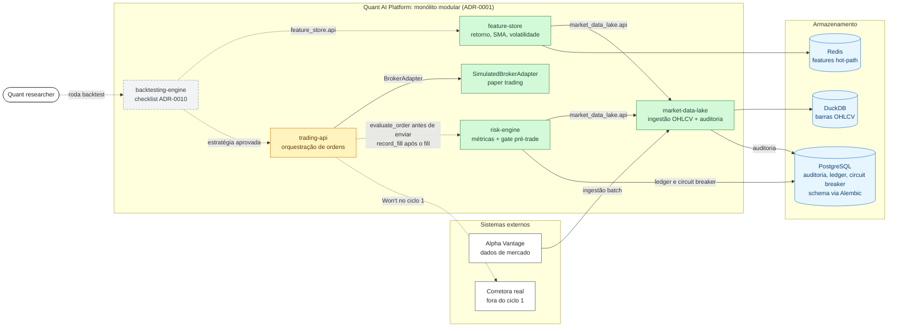

# Quant AI Platform

Plataforma modular de **trading quantitativo** que integra Engenharia de Dados,
Machine Learning, IA Generativa e Engenharia de Software para pesquisa,
backtesting, gestão de risco e execução de estratégias.

> **Status:** 🟡 em desenvolvimento, ambiente local/dev. Quatro módulos com
> código e testes; os demais têm escopo definido e aguardam spec.
> Nenhum módulo executa ordens reais: a execução existe apenas como paper
> trading simulado, sem credenciais de corretora.

> **Aviso:** projeto de estudo e portfólio. Não é recomendação de investimento
> e não deve ser usado com capital real.

## Por que este projeto

Em vez de 14 projetos isolados, cada capacidade é um **módulo com fronteira
clara** dentro de um monólito modular ([ADR-0001](docs/adr/0001-modular-monolith-vs-microservices.md)).
Os módulos conversam só por APIs públicas (`<modulo>.api`), e essa regra é
verificada automaticamente no CI. Assim cada peça evolui de forma independente
sem virar um sistema distribuído antes da hora.

O foco é mostrar **engenharia aplicada a um domínio de risco alto**: o dinheiro
é tratado com `Decimal`, o gate de risco bloqueia por padrão quando falha, as
ordens são idempotentes e cada decisão estrutural tem um ADR.

## Arquitetura

Estado atual e MVP do ciclo 1 ([docs/vision.md](docs/vision.md)). Módulos
conversam só pela API pública de cada um (`<modulo>.api`); setas tracejadas
ainda não existem no código.



Verde: implementado e testado. Amarelo: parcial (só o port de corretora;
falta a orquestração). Cinza tracejado: MVP planejado. Camadas internas,
regras de dependência e o fluxo de uma ordem em paper trading:
[docs/architecture/estado-atual.md](docs/architecture/estado-atual.md).
A arquitetura-alvo completa (14 módulos) está nos diagramas
[C4](docs/architecture/README.md).

## Estado dos módulos

| Módulo | Status | O que já existe |
|---|---|---|
| [`market-data-lake`](market-data-lake/) | 🟡 v1 local | OHLCV diário (provider mock + Alpha Vantage), DuckDB, auditoria de ingestão em Postgres |
| [`feature-store`](feature-store/) | 🟡 v1 local | Retorno diário, SMA e volatilidade; leitura online em Redis |
| [`risk-engine`](risk-engine/) | 🟡 v1 local | Sharpe, Sortino, Calmar, VaR, drawdown + gate pré-trade fail-closed com circuit breaker |
| [`trading-api`](trading-api/) | 🟡 parcial | Port `BrokerAdapter` e `SimulatedBrokerAdapter` (paper trading, idempotente por `client_order_id`) |
| [`infrastructure`](infrastructure/) | 🟡 parcial | Docker Compose local (Postgres + Redis) |
| `backtesting-engine`, `portfolio-optimizer`, `ml-predictions`, `reinforcement-learning`, `financial-rag`, `investment-copilot`, `streaming-engine`, `trading-dashboard`, `monitoring`, `notebooks` | 📋 planejado | README com escopo; código só depois da spec |

## Como executar localmente

Pré-requisitos: [uv](https://docs.astral.sh/uv/getting-started/installation/),
Docker e Git. O uv instala o Python fixado em [`.python-version`](.python-version)
e as versões travadas em [`uv.lock`](uv.lock): local e CI usam o mesmo
ambiente ([ADR-0011](docs/adr/0011-uv-workspace-lockfile.md)).

```bash
# 1. Infra local (Postgres + Redis)
docker compose -f infrastructure/docker-compose.local.yml up -d

# 2. Ambiente (.venv) com os módulos implementados e as ferramentas de dev
uv sync --all-packages

# 3. Testes (contra Postgres/Redis reais, em banco exclusivo de teste;
#    as fixtures aplicam as migrações no banco de teste)
uv run pytest market-data-lake feature-store risk-engine trading-api

# 4. Para usar os módulos em dev: schema do banco de dev via migrações
uv run alembic -c market-data-lake/alembic.ini upgrade head
uv run alembic -c risk-engine/alembic.ini upgrade head
```

O schema do Postgres vem só das migrações versionadas de cada módulo
([ADR-0012](docs/adr/0012-schema-migrations-alembic.md)): os repositórios não
criam tabelas.

Em rede com inspeção TLS (proxy ou antivírus corporativo), defina
`UV_SYSTEM_CERTS=1` para o uv usar os certificados do sistema. Não desligue
a verificação.

A suíte usa o banco `quant_platform_test` e o db 15 do Redis, nunca os dados de
dev. Sem infraestrutura de pé, os testes de integração são pulados; com
`QUANT_REQUIRE_INTEGRATION=1` (padrão no CI), eles falham. Variáveis de
configuração estão em [`.env.example`](.env.example). Porta 5432 ocupada,
volume antigo sem o banco de teste e outros problemas comuns:
[infrastructure/README.md](infrastructure/README.md).

## Princípios de engenharia

- **Spec antes do código.** Cada módulo tem `docs/spec.md` com escopo,
  contrato e critérios de aceite verificáveis.
- **Clean Architecture por módulo:** `domain` / `application` /
  `infrastructure` / `api`. As fronteiras entre camadas e módulos são
  validadas por [import-linter](.importlinter).
- **ADRs** para toda decisão cara de reverter ou que afete mais de um módulo.
- **`Decimal`, nunca `float`**, em dinheiro, exposição e P&L
  ([ADR-0004](docs/adr/0004-money-precision-standard.md)). `float64` só no
  modo analítico, onde a precisão de centavo não é o requisito.
- **Testes contra infraestrutura real** (Postgres, Redis, DuckDB), sem mock
  de banco.
- **Nenhuma ordem real sem gate de risco e paper trading aprovado.** O
  `risk-engine` bloqueia antes do envio e, se falhar, bloqueia por padrão
  ([ADR-0006](docs/adr/0006-risk-engine-pre-trade-gate.md)). Toda
  estratégia passa por paper trading com critério de promoção
  ([ADR-0008](docs/adr/0008-paper-trading-gate.md)).
- **Credencial de execução nunca em texto plano**: secrets manager, rotação
  e redação em logs ([ADR-0009](docs/adr/0009-secrets-management.md)).

## Qualidade automatizada

Cada push e pull request para `main` roda no [CI](.github/workflows/ci.yml):

- `uv sync --locked`: falha se o lockfile estiver desatualizado
- `ruff` (lint e formatação) e `mypy` (tipos)
- `bandit` (análise de segurança) e `pip-audit` (vulnerabilidades no lockfile)
- migrações: `upgrade → downgrade → upgrade` em Postgres vazio
- `pytest` com cobertura, contra Postgres e Redis reais
- `lint-imports` (fronteiras do monólito modular)

## Roadmap

**Ciclo atual:** um MVP de três capacidades: dados confiáveis → backtest
validado → paper trading sob o gate de risco, para uma estratégia de
referência. Escopo, prioridades (MoSCoW) e critério de saída em
[docs/vision.md](docs/vision.md). As fases abaixo são o horizonte completo,
não o compromisso deste ciclo.

| Fase | Módulos | Objetivo |
|---|---|---|
| 0: Fundação ✅ | `docs/` (C4 + ADRs), CI | Arquitetura e decisões antes do código |
| 1: Dados 🟡 | `market-data-lake`, `feature-store` | Base de dados confiável e versionada |
| 2: Análise 🟡 | `risk-engine`, `backtesting-engine` | Validar estratégias: métricas, gate pré-trade e checklist anti-overfitting ([ADR-0010](docs/adr/0010-backtesting-validation-checklist.md)) |
| 3: Inteligência | `ml-predictions`, `financial-rag`, `investment-copilot` | Camada de ML e IA generativa |
| 4: Produto 🟡 | `trading-api`, `trading-dashboard`, `portfolio-optimizer` | Superfície de uso, com kill switch, idempotência e reconciliação ([ADR-0007](docs/adr/0007-trading-api-safety-layers.md)) |
| 5: Operação | `infrastructure`, `monitoring`, `reinforcement-learning` | Produção, observabilidade e experimentação avançada |

Próximos passos de engenharia: logs estruturados e rastreabilidade de
critério de aceite até o teste correspondente.

## Documentação

- [Visão e MVP do ciclo atual](docs/vision.md)
- [Arquitetura: estado atual](docs/architecture/estado-atual.md) (camadas,
  fluxo de uma ordem, pipeline de CI)
- Arquitetura-alvo (C4): [Contexto](docs/architecture/c4/c1-context.md) ·
  [Containers](docs/architecture/c4/c2-container.md) ·
  [Componentes](docs/architecture/c4/c3-components.md)
- [ADRs: decisões arquiteturais](docs/adr/README.md)
- Specs: [market-data-lake](market-data-lake/docs/spec.md) ·
  [feature-store](feature-store/docs/spec.md) ·
  [risk-engine](risk-engine/docs/spec.md) ·
  [trading-api](trading-api/docs/spec.md)

## Licença

[MIT](LICENSE) © 2026 Fabio Estevam
