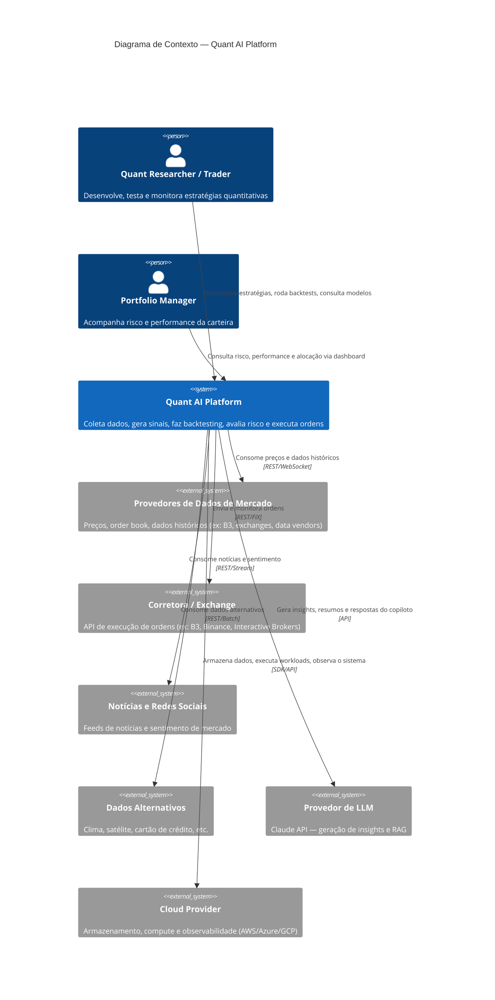

# C4 — Nível 1: Diagrama de Contexto

Mostra a Quant AI Platform como uma caixa única, seus usuários e os sistemas
externos com os quais ela troca dados.

## Atores

| Ator | Descrição |
|---|---|
| Quant Researcher / Trader | Constrói e valida estratégias; interage com backtesting e feature store |
| Portfolio Manager | Consome dashboards de risco e performance; não escreve código |

## Sistemas externos

| Sistema | Papel | Observação |
|---|---|---|
| Provedores de Dados de Mercado | Fonte de preços/OHLCV/order book | Pode ser multi-fonte (redundância) |
| Corretora / Exchange | Execução real de ordens | Isolado atrás de um `trading-api` — nunca acoplado direto às estratégias |
| Notícias e Redes Sociais | Sinal de sentimento | Usado por `financial-rag` e `ml-predictions` |
| Dados Alternativos | Sinais não convencionais | Opcional, fase avançada |
| Provedor de LLM (Claude) | Geração de linguagem natural | Usado no `investment-copilot` e `financial-rag` |
| Cloud Provider | Infra base | Definido em `infrastructure/` |
