# C4 — Nível 2: Diagrama de Container

Abre a caixa "Quant AI Platform" e mostra os módulos (containers) internos e
como eles se comunicam.

```mermaid
C4Container
    title Diagrama de Container — Quant AI Platform

    Person(quant, "Quant Researcher")
    Person(pm, "Portfolio Manager")

    System_Boundary(platform, "Quant AI Platform") {

        Container(dashboard, "trading-dashboard", "Next.js", "UI de visualização, backtesting e operação")
        Container(api, "trading-api", "FastAPI", "API pública/interna: estratégias, ordens, portfólio")
        Container(copilot, "investment-copilot", "FastAPI + Claude API", "Copiloto conversacional para análise de investimentos")
        Container(rag, "financial-rag", "Python + Vector DB", "RAG sobre relatórios, filings e notícias")

        Container(backtest, "backtesting-engine", "Python", "Simula estratégias sobre dados históricos")
        Container(risk, "risk-engine", "Python", "Calcula VaR, Sharpe, drawdown, exposição")
        Container(optimizer, "portfolio-optimizer", "Python", "Otimização de alocação de carteira")
        Container(mlpred, "ml-predictions", "Python", "Modelos supervisionados de previsão")
        Container(rl, "reinforcement-learning", "Python", "Agentes de RL para execução/alocação")

        Container(streaming, "streaming-engine", "Kafka + Python", "Ingestão e processamento de dados em tempo real")
        Container(datalake, "market-data-lake", "Python + Airflow", "Ingestão, versionamento e histórico de dados de mercado")
        Container(featurestore, "feature-store", "Python", "Features versionadas para treino e inferência")

        ContainerDb(pg, "PostgreSQL", "Dados transacionais, metadados, usuários, ordens")
        ContainerDb(ts, "ClickHouse / DuckDB", "Séries temporais e dados de mercado em larga escala")
        ContainerDb(cache, "Redis", "Cache, filas leves, feature store hot-path")
        ContainerQueue(kafka, "Kafka", "Barramento de eventos de mercado e sinais")
        ContainerDb(secrets, "Secrets Manager", "AWS Secrets Manager / Vault — credenciais de corretora, nunca texto plano (ADR-0009)")
    }

    System_Ext(broker, "Corretora / Exchange")
    System_Ext(marketdata, "Provedores de Dados")
    System_Ext(llm, "Claude API")

    Rel(quant, dashboard, "Usa", "HTTPS")
    Rel(pm, dashboard, "Usa", "HTTPS")
    Rel(dashboard, api, "Consome", "REST/JSON")

    Rel(api, backtest, "Solicita simulações")
    Rel(api, risk, "Solicita métricas de risco (modo analítico)")
    Rel(api, risk, "Valida ordem contra limites antes de enviar — gate síncrono pré-trade (ADR-0006)")
    Rel(api, optimizer, "Solicita alocação ótima")
    Rel(api, secrets, "Lê credenciais de corretora (ADR-0009)", "SDK")
    Rel(api, broker, "Envia ordens — só após gate de risco + kill switch off (ADR-0006/0007)", "REST/FIX")

    Rel(dashboard, copilot, "Conversa via chat")
    Rel(copilot, rag, "Consulta contexto")
    Rel(copilot, llm, "Gera resposta")
    Rel(rag, llm, "Gera embeddings/respostas")

    Rel(mlpred, featurestore, "Lê features")
    Rel(rl, featurestore, "Lê features")
    Rel(backtest, featurestore, "Lê features")
    Rel(risk, datalake, "Lê séries históricas via market_data_lake.api")

    Rel(streaming, marketdata, "Consome via WebSocket")
    Rel(streaming, kafka, "Publica eventos")
    Rel(datalake, marketdata, "Ingestão batch/histórica")
    Rel(datalake, ts, "Persiste séries")
    Rel(featurestore, datalake, "Lê dados brutos via market_data_lake.api")
    Rel(featurestore, cache, "Serve features hot-path")

    Rel(api, pg, "Lê/escreve")
    Rel(kafka, featurestore, "Alimenta features em tempo real")
```

## Racional das fronteiras

- **`trading-api` é o único container com permissão de falar com a corretora.**
  Nenhum módulo de análise (`backtest`, `risk`, `ml-predictions`) toca a API
  da corretora diretamente — isso é o que torna o backtesting seguro e o
  paper trading trivial de isolar (ADR-0001).
- **`market-data-lake` vs `streaming-engine`**: o primeiro é a fonte de
  verdade histórica (batch, versionada); o segundo é o caminho de baixa
  latência para sinais em tempo real. Eles convergem no `feature-store`.
- **Nenhum módulo lê o armazenamento de outro.** `feature-store` e
  `risk-engine` leem séries pela API do `market-data-lake`, nunca direto do
  DuckDB/ClickHouse — regra verificada pelo import-linter (ADR-0001).
- **`feature-store` é o único ponto de leitura de features** tanto para
  treino (`ml-predictions`, `reinforcement-learning`) quanto para simulação
  (`backtesting-engine`) — evita o clássico bug de *train/serve skew*.
- **`risk-engine` tem papel duplo desde que capital real entrou em jogo**
  (ADR-0006): além do modo analítico (Sharpe, VaR, drawdown para
  dashboard), atua como gate síncrono — `trading-api` bloqueia por padrão
  (fail-closed) se `risk-engine` não responder ou recusar a ordem.
- **`trading-api` nunca fala com a corretora sem passar pelo gate de risco,
  pelo kill switch e por idempotência de ordem** (ADR-0006, ADR-0007) — e
  mantém limites de posição hard-coded como última linha de defesa,
  independente do `risk-engine` estar disponível.
- **Credencial de corretora nunca é variável de ambiente em texto plano**
  (ADR-0009) — só via `secrets`, com rotação e log redigido em toda a
  plataforma, não só em `trading-api`.
