# C4 — Nível 3: Diagrama de Componentes

Este documento propõe um desenho de componentes para a plataforma, com foco em:
- bordas de serviço claras
- integração `investment-copilot` / `financial-rag`
- fluxo de dados entre módulos
- uso correto dos stores e barramento de eventos

## Diagrama de componentes

```mermaid
C4Component
    title Componente de Plataforma Quant AI e IA/RAG

    Person(quant, "Quant Researcher", "Desenvolve e valida estratégias")
    Person(pm, "Portfolio Manager", "Consulta risco e performance")

    System_Boundary(platform, "Quant AI Platform") {
        Container(dashboard, "trading-dashboard", "Next.js", "UI de visualização e operação")
        Container(api, "trading-api", "FastAPI", "API de negócio e execução")
        Container(copilot, "investment-copilot", "FastAPI", "Chat e insights de investimento")
        Container(rag, "financial-rag", "Python + Vector DB", "Contexto financeiro, embeddings e semântica")

        Container(backtest, "backtesting-engine", "Python", "Simula estratégias históricas")
        Container(risk, "risk-engine", "Python", "Calcula VaR, drawdown e riscos")
        Container(optimizer, "portfolio-optimizer", "Python", "Otimiza alocação")
        Container(mlpred, "ml-predictions", "Python", "Treina e serve modelos de previsão")
        Container(rl, "reinforcement-learning", "Python", "Agentes de RL para alocação/executação")

        Container(streaming, "streaming-engine", "Kafka + Python", "Ingestão e pipeline de eventos")
        Container(datalake, "market-data-lake", "Python + Airflow", "Ingestão e versionamento de dados")
        Container(featurestore, "feature-store", "Python", "Feature store versionada")

        ContainerDb(pg, "PostgreSQL", "Transacional e metadados")
        ContainerDb(ts, "ClickHouse / DuckDB", "Séries temporais e análises históricas")
        ContainerDb(cache, "Redis", "Cache, lookup rápido, feature hot-path")
        ContainerDb(vector, "Vector DB", "Retrieval semântico e embeddings")
        ContainerQueue(kafka, "Kafka", "Eventos de mercado, signals e integrações")
        ContainerDb(secrets, "Secrets Manager", "AWS Secrets Manager / Vault — credenciais de corretora (ADR-0009)")
    }

    System_Ext(broker, "Corretora / Exchange", "Execução de ordens")
    System_Ext(marketdata, "Provedores de Dados de Mercado", "Preços, cotações, métricas")
    System_Ext(llm, "Provedor de LLM", "Claude API / Anthropic")

    Rel(quant, dashboard, "Usa", "HTTPS")
    Rel(pm, dashboard, "Usa", "HTTPS")
    Rel(dashboard, api, "Consome", "REST/JSON")

    Rel(api, backtest, "Invoca simulações", "gRPC/REST")
    Rel(api, risk, "Consulta métricas (modo analítico)", "gRPC/REST")
    Rel(api, risk, "Valida ordem — gate síncrono pré-trade, fail-closed (ADR-0006)", "gRPC/REST")
    Rel(api, optimizer, "Solicita otimização", "gRPC/REST")
    Rel(api, secrets, "Lê credencial de corretora, nunca em env var (ADR-0009)", "SDK")
    Rel(api, broker, "Envia ordens — após gate + kill switch off + idempotência (ADR-0007)", "REST/FIX")
    Rel(api, pg, "Lê/escreve estado e ordens", "SQL")

    Rel(copilot, rag, "Solicita contexto e documentos", "REST/SDK")
    Rel(copilot, llm, "Gera respostas e prompts", "HTTPS")
    Rel(rag, llm, "Gera embeddings e respostas", "HTTPS")
    Rel(copilot, cache, "Busca contexto rápido", "Redis")

    Rel(backtest, featurestore, "Lê features", "Python API")
    Rel(mlpred, featurestore, "Lê features", "Python API")
    Rel(rl, featurestore, "Lê features", "Python API")
    Rel(featurestore, ts, "Lê séries históricas", "SQL")
    Rel(featurestore, cache, "Lê/grava features hot-path", "Redis")

    Rel(streaming, marketdata, "Ingestão de dados em tempo real", "WebSocket/API")
    Rel(streaming, kafka, "Publica eventos", "Kafka")
    Rel(datalake, marketdata, "Ingestão batch", "REST/FTP")
    Rel(datalake, ts, "Persiste séries", "SQL")

    Rel(rag, vector, "Indexa e consulta embeddings", "Vector API")
    Rel(rag, ts, "Consulta histórico e documentos", "SQL")
    Rel(rag, cache, "Busca metadados e sessão", "Redis")

    Rel(copilot, api, "Opções de usuário e contexto de portfólio", "REST/JSON")
    Rel(copilot, pg, "Persistência de sessão e logs", "SQL")

    Rel(api, kafka, "Publica sinais e eventos", "Kafka")
    Rel(rl, kafka, "Consome eventos e publica ações", "Kafka")

    Rel(broker, api, "Retorna status de execução", "REST/FIX")

    Rel(quant, backtest, "Acessa simulações via API interna", "REST/CLI")
    Rel(quant, mlpred, "Avalia modelos e métricas", "Python/CMD")
```

## Recomendações de arquitetura

1. **Formalizar contratos de API interna** entre módulos:
   - `feature-store.api`
   - `backtesting-engine.api`
   - `financial-rag.api`
   - `investment-copilot.api`

2. **Separar claramente**:
   - runtime de serviço (`trading-api`, `dashboard`, `streaming-engine`)
   - jobs batch/analíticos (`backtesting-engine`, `ml-predictions`, `portfolio-optimizer`, `reinforcement-learning`)
   - `risk-engine` não é puramente batch — desde ADR-0006 tem um modo
     síncrono de baixa latência (gate pré-trade) chamado por `trading-api`,
     além do modo analítico batch. Tratar os dois modos com SLAs distintos.

3. **Fazer do RAG um serviço de contexto** para o copilot:
   - `investment-copilot` monta prompt e orquestra chamadas
   - `financial-rag` entrega documentos, embeddings e contexto semântico
   - `LLM Provider` é apenas a camada final de geração

4. **Validar fronteiras no CI** com import-linter e testes de contrato.

5. **Usar `Kafka` e `Redis` apenas para os caminhos que precisam de baixa latência**:
   - eventos de mercado e sinais em tempo real no Kafka
   - features hot-path e sessão no Redis

6. **Nenhuma ordem sai de `trading-api` sem passar pelas quatro camadas de
   segurança** (ADR-0006, ADR-0007): gate síncrono de risco (fail-closed),
   kill switch desligado, idempotência por `client_order_id`, e position
   limits hard-coded como última linha de defesa. Estratégia só chega a
   `trading-api` depois de aprovada em paper trading (ADR-0008), que por
   sua vez exige o checklist de validação do `backtesting-engine`
   (ADR-0010).

## Como usar esse desenho

- Este diagrama deve ser lido como um nível intermediário entre o container e as classes.
- Ele ajuda a validar onde cada módulo vive e como as dependências fluem.
- As implementações podem ser construídas em cima dele com `package layout` e `pyproject` por módulo.
