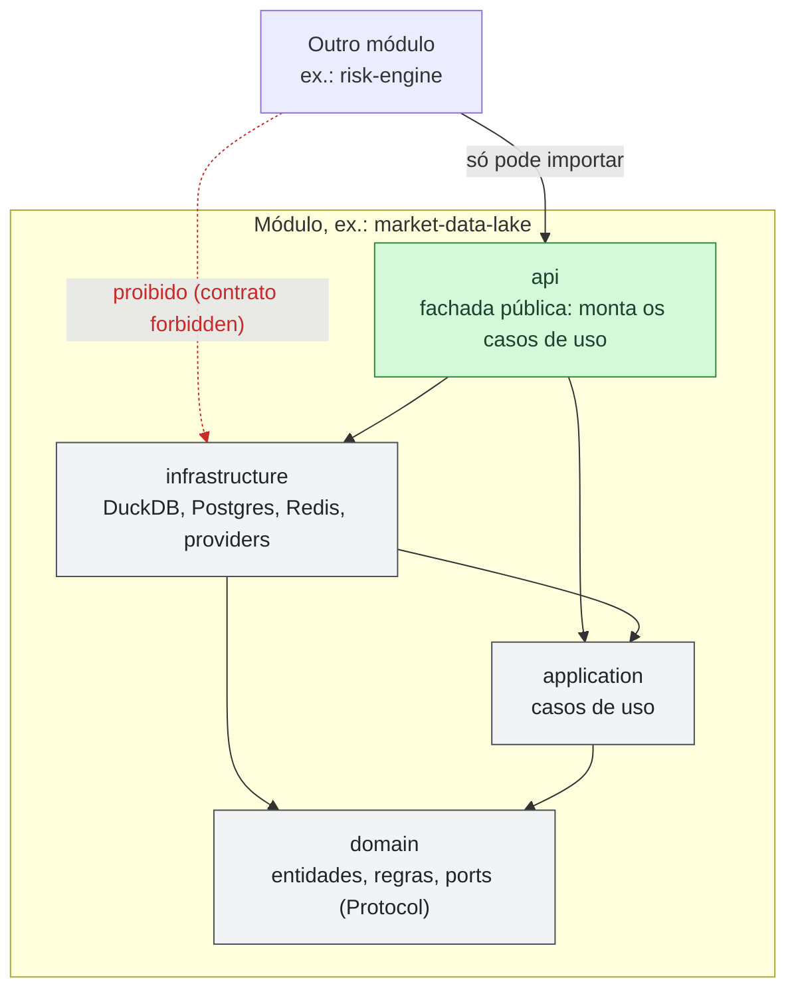
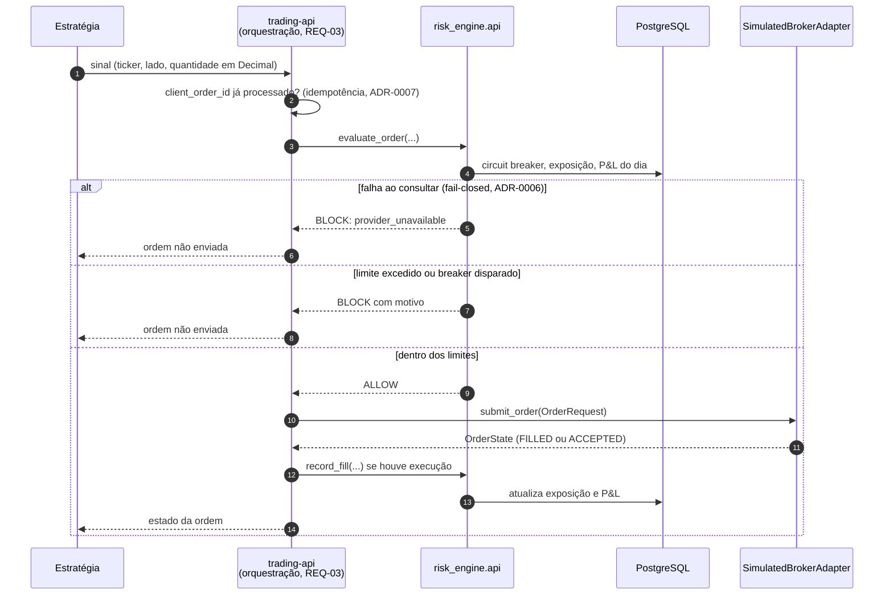
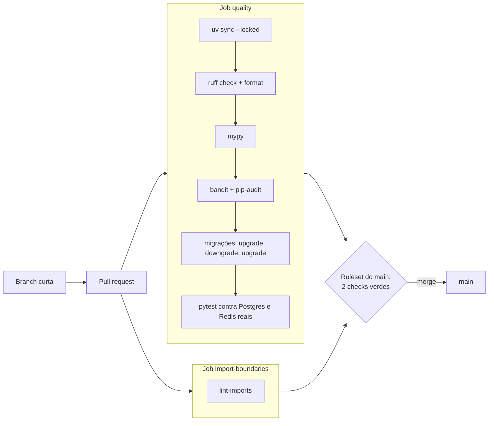

# Arquitetura — estado atual e MVP do ciclo 1

Os diagramas [C4](README.md) descrevem a arquitetura-alvo completa. Este
documento mostra o que existe no código hoje e o que o MVP do ciclo 1
([vision.md](../vision.md)) acrescenta. A visão geral dos módulos está no
[README](../../README.md#arquitetura).

## Camadas dentro de cada módulo

Cada módulo segue Clean Architecture. A regra é verificada pelo
`import-linter` no CI ([`.importlinter`](../../.importlinter)): uma camada só
importa as camadas abaixo dela.

| Contrato do import-linter | Regra |
|---|---|
| `*-layers` (um por módulo) | `api` → `infrastructure` → `application` → `domain`; nunca no sentido inverso |
| `feature-store-so-usa-market-data-lake-api` | `feature_store` importa só `market_data_lake.api` |
| `risk-engine-so-usa-market-data-lake-api` | `risk_engine` importa só `market_data_lake.api` |
| `trading-api-layers` | `infrastructure` → `domain`; `application`/`api` entram com a orquestração (REQ-03) |

O schema de cada banco pertence ao módulo que o usa, com migrações e tabela
de versão próprias ([ADR-0012](../adr/0012-schema-migrations-alembic.md)).

## Fluxo de uma ordem em paper trading (MVP, REQ-03)

O gate de risco e o adapter simulado já existem; a orquestração no
`trading-api` é o que o REQ-03 constrói.

Já implementado e testado: `evaluate_order`, `record_fill`, circuit breaker,
`BrokerAdapter` e `SimulatedBrokerAdapter`. Planejado no REQ-03: a
orquestração (passos 1–2 e as chamadas entre `trading-api` e `risk-engine`),
o ledger de idempotência persistido, o kill switch e a reconciliação
(ADR-0007).

## Como uma mudança chega ao `main`

Push direto e force push no `main` são bloqueados pelo ruleset; o merge
exige os dois jobs verdes e não exige aprovação de outra pessoa (fluxo solo).

## Diferenças em relação aos diagramas C4

| Item | C4 (alvo) | Hoje |
|---|---|---|
| `market-data-lake` | Python + Airflow, ClickHouse/DuckDB | Python, DuckDB local; orquestração e ClickHouse ficam para produção (ADR-0003) |
| `trading-api` | FastAPI, PostgreSQL, Secrets Manager | Biblioteca Python (port + adapter simulado); sem HTTP nem credenciais neste ciclo |
| Kafka, Vector DB, Secrets Manager | Presentes | Ausentes: módulos que os usam são Won't no ciclo 1 |
