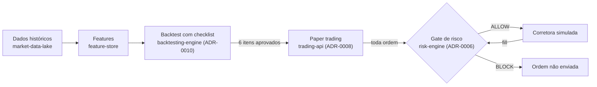

# Visão e MVP — ciclo 1

**Status:** Rascunho — 5 decisões pendentes (ver [Decisões em aberto](#decisões-em-aberto))
**Data:** 2026-11-01
**Revisar quando:** uma decisão em aberto for tomada, ou ao fim do ciclo.

## Problema

Estratégias quantitativas costumam parecer lucrativas em backtest e perder
dinheiro na prática. As causas mais comuns não são de execução, mas de
validação: look-ahead bias, viés de sobrevivência, ausência de custos e
overfitting aos parâmetros ([ADR-0010](adr/0010-backtesting-validation-checklist.md)).
Quando a estratégia chega a operar, falta um controle de risco que bloqueie
antes de enviar a ordem, não só um relatório depois ([ADR-0006](adr/0006-risk-engine-pre-trade-gate.md)).

## Para quem

**Quant researcher** (ator do [C1](architecture/c4/c1-context.md)): escreve
uma estratégia, quer saber se ela sobrevive a uma validação honesta e vê-la
operar em paper trading sob limites de risco.

O Portfolio Manager (o outro ator do C1) fica fora deste ciclo: o fluxo dele
depende de dashboard e de várias estratégias rodando.

## Resultado esperado do ciclo

Uma estratégia de referência percorre o caminho completo, de dados até paper
trading, com cada etapa verificável:

O que o ciclo **não** promete: estratégia lucrativa. Promete que o resultado,
seja ele qual for, é confiável — e que nenhuma ordem passa sem o gate.

## MVP: três capacidades (MoSCoW)

| ID | Capacidade | Prioridade | Situação |
|---|---|---|---|
| REQ-01 | Dados históricos confiáveis para o universo do MVP: ingestão real, persistida, auditada, reprocessável | **Must** | 🟡 Base pronta (`market-data-lake`, `feature-store`); falta ingestão real do universo escolhido |
| REQ-02 | Backtest de uma estratégia de referência com relatório que preenche os 6 itens do ADR-0010 (custos, walk-forward, out-of-sample, robustez…) | **Must** | 📋 `backtesting-engine` sem spec |
| REQ-03 | Paper trading da mesma estratégia: toda ordem consulta o gate antes de sair; fills alimentam o ledger; idempotência e reconciliação (ADR-0007) | **Must** | 🟡 Gate e port de corretora prontos; falta a orquestração no `trading-api` |

### Demais itens

| Prioridade | Itens |
|---|---|
| **Should** — importante, admite alternativa manual | Relatório de aderência paper × backtest (critérios do ADR-0008) em CLI/Markdown; logs estruturados e runbook (item 8 da fundação) |
| **Could** — desejável se sobrar tempo | `trading-dashboard` mínimo; `portfolio-optimizer` com mais de uma estratégia |
| **Won't neste ciclo** | `reinforcement-learning`, `streaming-engine`, `financial-rag`, `investment-copilot`, `ml-predictions`; adapter de corretora real e qualquer capital real; ClickHouse, Kafka, Kubernetes; dados alternativos |

Won't significa "não neste ciclo", não "nunca": os módulos continuam no
roadmap do [README](../README.md) e voltam à priorização na revisão do ciclo.

## Requisitos de qualidade

| ID | Requisito | Evidência |
|---|---|---|
| QA-01 | Nenhuma ordem chega ao adapter de corretora sem decisão `ALLOW` do gate | Teste do fluxo de paper trading; contagem ordens enviadas = ordens com `ALLOW` |
| QA-02 | Dinheiro, exposição e P&L em `Decimal` de ponta a ponta | Critério 3 do `risk-engine` e do `trading-api` (já coberto) |
| QA-03 | Backtest reproduzível: mesmos dados e parâmetros → mesmo relatório | Teste de determinismo no `backtesting-engine` |
| QA-04 | Sem look-ahead: a decisão em `t` só usa dados até `t` | Teste que injeta dado futuro e falha se ele alterar a decisão |
| QA-05 | Fluxo completo executável a partir de clone limpo, com dados fictícios | Comando documentado no README, repetido no CI |

## Critério de saída do ciclo

- A estratégia de referência tem relatório de backtest com os 6 itens do
  ADR-0010 respondidos — "não verificado" conta como reprovado.
- Paper trading rodou pelo período definido na decisão 3, com zero ordens
  fora do gate (QA-01) e zero divergências de reconciliação não explicadas.
- REQ-01 a REQ-03 com critérios de aceite nas specs e na matriz de
  rastreabilidade, todos verdes no CI.

Atingir o critério **não** promove a estratégia para capital real — isso
exige o processo do ADR-0008 e um adapter de corretora real, fora deste ciclo.

## Riscos e hipóteses

| Risco | Impacto | Mitigação proposta |
|---|---|---|
| Viés de sobrevivência exige o histórico de ativos que saíram do índice; fontes gratuitas raramente têm | Item 2 do ADR-0010 fica "não verificado" e bloqueia a promoção a paper | Investigação curta antes da spec do backtest; se inviável, registrar a limitação e restringir o universo de forma declarada (decisão 2) |
| Limites de uso da API de dados (Alpha Vantage) | Ingestão do universo inteiro demora ou falha | Universo pequeno no MVP; ingestão incremental e idempotente |
| Paper trading em tempo real leva semanas (ADR-0008 pede ≥ 20 pregões) | Ciclo longo para o critério de saída | Decisão 3: separar validação do fluxo (replay) de validação da estratégia (tempo real) |
| `backtesting-engine` próprio (ADR-0005) é o maior bloco ainda não iniciado | Concentra o risco de prazo do ciclo | Spec enxuta: uma estratégia, um timeframe (diário), custos simples e fixos |

## Decisões em aberto

Cada uma muda o escopo das specs seguintes. Proposta inicial entre colchetes.

1. **Estratégia de referência.** [Cruzamento de médias móveis em barras
   diárias: simples de explicar e de verificar à mão, e exercita todo o
   fluxo. O objetivo do ciclo é o processo, não a estratégia.]
2. **Universo de ativos.** [3 a 5 ações líquidas da B3, declarado como
   universo fixo, com a limitação de sobrevivência registrada no relatório.]
3. **Paper trading: tempo real ou replay.** [Ambos, em etapas: replay
   acelerado sobre histórico para validar o fluxo e o gate; depois paper em
   tempo real pelos 20 pregões do ADR-0008.]
4. **Fonte de dados real.** [Alpha Vantage, que já tem provider
   implementado; avaliar outra fonte só se o risco de limites se confirmar.]
5. **Duração do ciclo.** [Com o ritmo de 10 h/semana: cerca de 8 semanas
   para REQ-01 a REQ-03 em replay, mais o período de paper em tempo real.]

## Rastreabilidade

`REQ-xx` (este documento) → spec do módulo → issue → PR → teste. Cada REQ
ganha critérios de aceite na spec do módulo responsável; a matriz de
rastreabilidade da spec liga cada critério ao teste.
