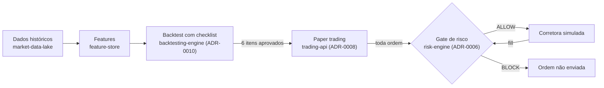

# Visão e MVP — ciclo 1

**Status:** Aceito — decisões registradas em [Decisões do ciclo](#decisões-do-ciclo)
**Data:** 2026-11-01
**Ciclo:** 2026-11-02 a 2026-12-27 (REQ-01 a REQ-03 em replay), seguido de
paper trading em tempo real
**Revisar quando:** ao fim do ciclo, ou se um risco abaixo invalidar uma decisão.

## Problema

Estratégias quantitativas costumam parecer lucrativas em backtest e perder
dinheiro na prática. As causas mais comuns não são de execução, mas de
validação: look-ahead bias, viés de sobrevivência, ausência de custos e
overfitting aos parâmetros ([ADR-0010](adr/0010-backtesting-validation-checklist.md)).
Quando a estratégia chega a operar, falta um controle de risco que bloqueie
antes de enviar a ordem, não só um relatório depois ([ADR-0006](adr/0006-risk-engine-pre-trade-gate.md)).

## Para quem

**Quant researcher** (ator do [C1](architecture/c4/c1-context.md)): escreve
uma estratégia, quer saber se ela sobrevive a uma validação honesta e vê-la
operar em paper trading sob limites de risco.

O Portfolio Manager (o outro ator do C1) fica fora deste ciclo: o fluxo dele
depende de dashboard e de várias estratégias rodando.

## Resultado esperado do ciclo

Uma estratégia de referência percorre o caminho completo, de dados até paper
trading, com cada etapa verificável:

O que o ciclo **não** promete: estratégia lucrativa. Promete que o resultado,
seja ele qual for, é confiável — e que nenhuma ordem passa sem o gate.

## MVP: três capacidades (MoSCoW)

| ID | Capacidade | Prioridade | Situação |
|---|---|---|---|
| REQ-01 | Dados históricos confiáveis para o universo do MVP: ingestão real, persistida, auditada, reprocessável | **Must** | 🟡 Base pronta (`market-data-lake`, `feature-store`); falta ingestão real do universo escolhido |
| REQ-02 | Backtest de uma estratégia de referência com relatório que preenche os 6 itens do ADR-0010 (custos, walk-forward, out-of-sample, robustez…) | **Must** | 📋 `backtesting-engine` sem spec |
| REQ-03 | Paper trading da mesma estratégia: toda ordem consulta o gate antes de sair; fills alimentam o ledger; idempotência e reconciliação (ADR-0007) | **Must** | 🟡 Gate e port de corretora prontos; falta a orquestração no `trading-api` |

### Demais itens

| Prioridade | Itens |
|---|---|
| **Should** — importante, admite alternativa manual | Relatório de aderência paper × backtest (critérios do ADR-0008) em CLI/Markdown; logs estruturados e runbook (item 8 da fundação) |
| **Could** — desejável se sobrar tempo | `trading-dashboard` mínimo; `portfolio-optimizer` com mais de uma estratégia |
| **Won't neste ciclo** | `reinforcement-learning`, `streaming-engine`, `financial-rag`, `investment-copilot`, `ml-predictions`; adapter de corretora real e qualquer capital real; ClickHouse, Kafka, Kubernetes; dados alternativos |

Won't significa "não neste ciclo", não "nunca": os módulos continuam no
roadmap do [README](../README.md) e voltam à priorização na revisão do ciclo.

## Requisitos de qualidade

| ID | Requisito | Evidência |
|---|---|---|
| QA-01 | Nenhuma ordem chega ao adapter de corretora sem decisão `ALLOW` do gate | Teste do fluxo de paper trading; contagem ordens enviadas = ordens com `ALLOW` |
| QA-02 | Dinheiro, exposição e P&L em `Decimal` de ponta a ponta | Critério 3 do `risk-engine` e do `trading-api` (já coberto) |
| QA-03 | Backtest reproduzível: mesmos dados e parâmetros → mesmo relatório | Teste de determinismo no `backtesting-engine` |
| QA-04 | Sem look-ahead: a decisão em `t` só usa dados até `t` | Teste que injeta dado futuro e falha se ele alterar a decisão |
| QA-05 | Fluxo completo executável a partir de clone limpo, com dados fictícios | Comando documentado no README, repetido no CI |

## Critério de saída do ciclo

- A estratégia de referência tem relatório de backtest com os 6 itens do
  ADR-0010 respondidos — "não verificado" conta como reprovado.
- Paper trading rodou em replay sobre o histórico e depois por 20 pregões em
  tempo real (decisão 3), com zero ordens fora do gate (QA-01) e zero
  divergências de reconciliação não explicadas.
- REQ-01 a REQ-03 com critérios de aceite nas specs e na matriz de
  rastreabilidade, todos verdes no CI.

Atingir o critério **não** promove a estratégia para capital real — isso
exige o processo do ADR-0008 e um adapter de corretora real, fora deste ciclo.

## Riscos e hipóteses

| Risco | Impacto | Mitigação proposta |
|---|---|---|
| Viés de sobrevivência exige o histórico de ativos que saíram do índice; fontes gratuitas raramente têm | Item 2 do ADR-0010 fica "não verificado" e bloqueia a promoção a paper | **Investigado** ([0001](research/0001-vies-de-sobrevivencia-e-ajuste-de-precos.md)): inviável no ciclo 1 para o universo escolhido. Proposta: "limitação declarada" permite paper e bloqueia capital real ([ADR-0013](adr/0013-universo-declarado-no-checklist.md), aceito). Universo point-in-time (COTAHIST + carteiras do Ibovespa) vira candidato a Should do ciclo 2 |
| Preços ingeridos sem ajuste por proventos (`TIME_SERIES_DAILY`) | Sinais falsos em desdobramentos e retorno errado no backtest | Ajuste por proventos vira requisito do REQ-01 e item 7 do checklist (ADR-0013) |
| **Confirmado:** Alpha Vantage gratuita só entrega ~100 barras sem ajuste; histórico e série ajustada são premium | Decisão 4 original não atendia o REQ-01 | **Resolvido:** decisão 4 revista em 2026-11-02 para COTAHIST + ajuste próprio (investigação 0001, achado 5) |
| Fonte de proventos (desdobramentos, grupamentos, dividendos) para ajustar o COTAHIST ainda não identificada | Sem ela, o item 7 do checklist (ADR-0013) fica "não verificado" e bloqueia paper | Investigação curta (0002) antes da spec do REQ-01: fontes oficiais da B3/CVM, formato e cobertura para o universo do MVP |
| Acesso aos arquivos da B3 pode falhar por rede ou mudança de URL | Ingestão interrompida | Ingestão idempotente por arquivo anual; cache local dos ZIPs baixados; erro explícito com a URL tentada |
| Paper trading em tempo real leva semanas (ADR-0008 pede ≥ 20 pregões) | Ciclo longo para o critério de saída | Decisão 3: replay valida o fluxo dentro das 8 semanas; o tempo real roda depois, sem bloquear o restante |
| `backtesting-engine` próprio (ADR-0005) é o maior bloco ainda não iniciado | Concentra o risco de prazo do ciclo | Spec enxuta: uma estratégia, um timeframe (diário), custos simples e fixos |

## Decisões do ciclo

Aceitas em 2026-11-01. Cada uma delimita o escopo das specs seguintes;
mudar uma delas é mudança de escopo e volta a este documento.

| # | Decisão | Escolha | Motivo |
|---|---|---|---|
| 1 | Estratégia de referência | Cruzamento de médias móveis em barras diárias | Simples de explicar e de verificar à mão, e exercita todo o fluxo. O objetivo do ciclo é o processo, não a estratégia |
| 2 | Universo de ativos | PETR4, VALE3 e ITUB4 (até 5 ações líquidas da B3), universo fixo e declarado | Já usados no código e nos testes. A limitação de viés de sobrevivência é registrada no relatório de backtest, não omitida |
| 3 | Paper trading | Em duas etapas: replay acelerado sobre o histórico (valida o fluxo e o gate); depois 20 pregões em tempo real (critério do ADR-0008) | Separa a validação do sistema, rápida, da validação da estratégia, que exige tempo de mercado |
| 4 | Fonte de dados real | Séries históricas oficiais da B3 (COTAHIST) + ajuste próprio por proventos. *Revista em 2026-11-02; antes: Alpha Vantage* | Oficial, gratuita, sem chave nem limite de chamadas, desde 1986 e com ativos deslistados — a mesma base que o universo sem viés vai exigir no ciclo 2. A Alpha Vantage gratuita só entrega ~100 barras sem ajuste (investigação 0001, achado 5) |
| 5 | Duração | 8 semanas a 10 h/semana para REQ-01 a REQ-03 em replay (2026-11-02 a 2026-12-27), depois cerca de 1 mês de paper em tempo real | Ritmo de referência do guia de estudos |

### Ordem de execução

1. **REQ-02 — spec do `backtesting-engine`**, começando pela investigação
   do viés de sobrevivência (maior risco do ciclo).
2. **REQ-01 — ingestão real** do universo a partir do COTAHIST, com ajuste
   por proventos, precedida da investigação 0002 (fonte de proventos). A
   suíte continua usando o provider mock; o `AlphaVantageProvider` é
   corrigido ou retirado na mesma spec.
3. **REQ-03 — orquestração de paper trading** no `trading-api`: gate,
   idempotência, `record_fill` e reconciliação, primeiro em replay.
4. Paper trading em tempo real pelos 20 pregões.

## Rastreabilidade

`REQ-xx` (este documento) → spec do módulo → issue → PR → teste. Cada REQ
ganha critérios de aceite na spec do módulo responsável; a matriz de
rastreabilidade da spec liga cada critério ao teste.
